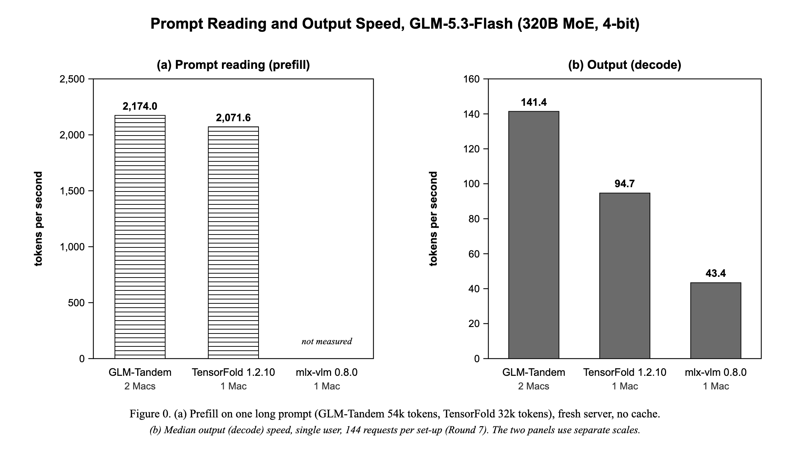
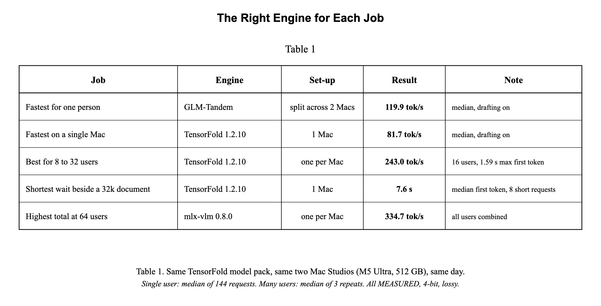
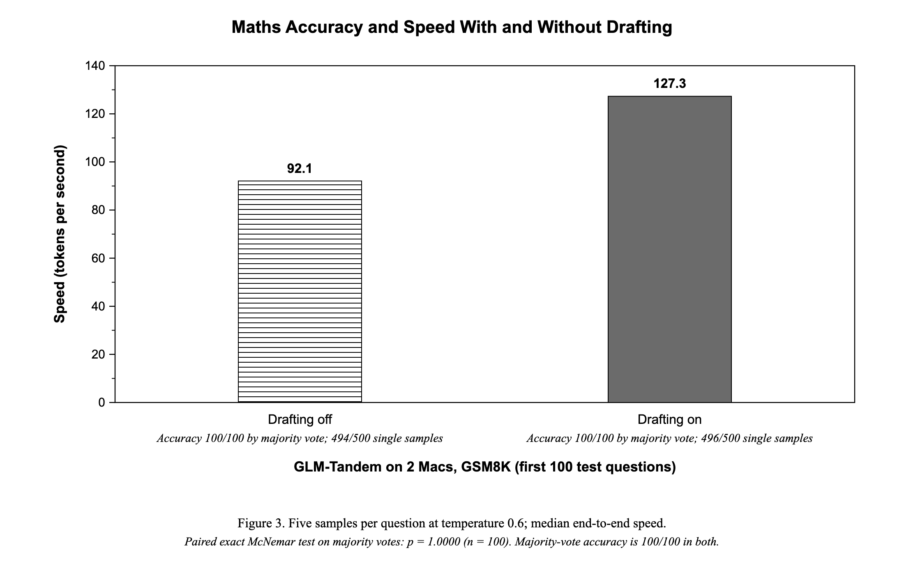
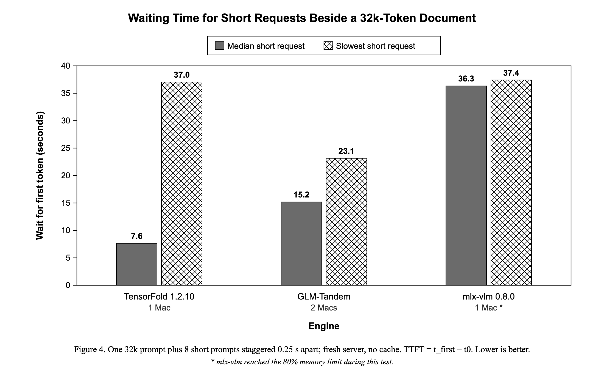

# GLM-5.3-Flash at 141 tok/s on two Mac Studio M5 Ultras (512 GB each)

**A 320-billion-parameter Mixture-of-Experts model running locally on Apple Silicon — measured, reproducible, with open data.** The 141 tok/s figure uses both Macs together; TensorFold and mlx-vlm results use one Mac.

**Reproduce it:** set up with [`SETUP.md`](SETUP.md), then follow [`AGENTS.md` → Quick replication (one Mac, ~1 hour)](AGENTS.md#quick-replication-one-mac-1-hour) to reproduce our one-Mac TensorFold number with the published prompts, pinned environments and scripts.

**Replication.** On 21 Nov 2026 a lab agent ran the timed steps of the one-Mac quick replication in [`AGENTS.md`](AGENTS.md#quick-replication-one-mac-1-hour) on the 16 published prompts over 3 fresh restarts (after restart 3's timed rows, the server answered the 16 prompts once more to record reply hashes): **79.12 tok/s** median end-to-end vs our receipt's 79.57 (-0.6%, inside the ±5% pass band: PASS), and decode 88.96 vs 88.94 tok/s, 96 requests each. Same model of hardware (Mac Studio M5 Ultra, 512 GB); it ran on our own lab machine, so it was not a third party. Receipt: [`receipts/replication-2026-11-21/`](receipts/replication-2026-11-21/README.md).

## Thank you

This work stands on other people's generosity. Thank you to **Ash Hart and TensorFold**, whose 4-bit model pack every 4-bit result here used and whose engine leads on one Mac; to **Z.ai** for releasing GLM-5.3-Flash openly; to **icryo** for GLM-Tandem; to **Apple's MLX team**; to **Blaizzy** (mlx-vlm), **jundot** (oMLX) and **the exo team**; and to the community members whose posts taught us what to test. Every name, with what each gave us, is in [`CREDITS.md`](CREDITS.md).

## Why, how, what — in plain words

**Why.** Very large AI models usually live in data centres. We wanted to know whether one of the largest open models could run fast and privately on two desktop computers, and which free engine is best for which job.

**How.** We joined two Apple Mac Studios with a single cable, gave every engine the same model, and timed real requests: one person, many people at once, long documents, and a maths test. The main Round 7 tests were repeated (3 fresh restarts for one person, 3 repeats of most many-users steps, 2 repeats of the long-document test); other results, such as the Round 5 many-users tests, are single runs. Every number comes from our own lab logs, and the per-request data for Rounds 6 and 7 is published in [`receipts/`](receipts/README.md).

**What we found.**
- **One person:** 141.4 tokens per second of output with the model split across both Macs; 94.7 on a single Mac with TensorFold.
- **Reading prompts:** over 2,000 tokens per second on either set-up, with prompts up to 53,990 tokens on two Macs and 127,996 tokens on one Mac.
- **Many people:** TensorFold, one per Mac, leads at 8, 16 and 32 users at once (level with GLM-Tandem at 2; not run at 4, 12, 20 or 24).
- **Accuracy:** on a 100-question maths test (GSM8K, 5 answers per question, majority vote) the model got 100 out of 100 right with and without drafting; single answers were 494/500 without and 496/500 with. On our own 200-question generated suite, drafting off scored 197/200 and drafting on 192/200 (the difference is not statistically significant, McNemar p = 0.1250).

## The numbers people ask for first

All `MEASURED`, `4-bit, lossy`, on the same TensorFold `GLM-5.3-Flash-MLX-4bit-MTP` model pack.

| | **GLM-Tandem** — 2 Macs, tensor-parallel over Thunderbolt 5 RDMA | **TensorFold 1.2.10** — 1 Mac | **mlx-vlm 0.8.0** — 1 Mac |
|---|---|---|---|
| **Prompt reading (prefill)** | **2,032.8 tok/s** at 13,985 tokens; **2,174.0** at 53,990 | **2,071.6 tok/s** at 31,995 tokens; **2,002.6** at 127,996 | **782–845 tok/s** at 14,004–53,695 tokens (19 Nov, one run each, preliminary; that text is not included in this repo) |
| **Output (decode), 1 user, median** | **141.4 tok/s** | **94.7 tok/s** | **43.4 tok/s** |
| **End-to-end, 1 user, median** | 119.9 tok/s | 81.7 tok/s | 41.7 tok/s |
| **Many users, total output** | 248.3 tok/s at 32 users | 271.8 tok/s at 32 users (one per Mac) | 334.7 tok/s at 64 users (one per Mac) |
| **Peak memory per Mac, 1 user** | 98.3 / 100.0 GB | 189.2 GB | 196.2 GB |
| **Longest prompt tested** | 53,990 tokens | 127,996 tokens | 53,695 tokens (19 Nov, one run, preliminary; that text is not included in this repo); 31,995 on RFC 9110 |

Prefill for GLM-Tandem and TensorFold: single long prompt, fresh server, no prompt cache ([`BENCHMARKS.md`](BENCHMARKS.md) §1.4); for mlx-vlm: one-shot `mlx_vlm.generate` runs on 19 Nov. Single-user output: 144 timed requests per set-up across 3 fresh restarts, Round 7. Many users: median of 3 repeats, Round 7 ([`BENCHMARKS.md`](BENCHMARKS.md) §2.3). Peak memory: Round 7 single-user runs; it rises under heavy load (see Questions people ask).

### Time to first token (how long before the first word appears)

First-token time (TTFT) was logged for every request; this table gathers the Round 7 values that are spread across [`BENCHMARKS.md`](BENCHMARKS.md) §2.3 and the many-users table below. Per-request data: [`receipts/r7-part2-requests.csv`](receipts/r7-part2-requests.csv) (column `ttft_s`). `MEASURED`, `4-bit, lossy`, `T=0`, `max_tokens=256`, `cached_tokens=0`, client sockets pre-connected; seconds, median (p50) / max, median of 3 repeats where repeated.

| Users at once | Prompt | **GLM-Tandem, 2 Macs** | Drafting on Tandem? | TensorFold, one per Mac | mlx-vlm, one per Mac |
|---|---|---|---|---|---|
| 1 | short (~95 tokens) | **0.35** / 0.35 | yes | not run | 0.39 / 0.39 |
| 2 | short | **0.64** / 0.66 | yes | 0.23 / 0.24 | 0.38 / 0.40 |
| 4 | short | **1.10** / 1.33 | yes | not run | 0.70 / 0.76 |
| 8 | short | **1.70** / 2.55 | no (ramp edges only) | 0.81 / 0.82 | 1.03 / 1.06 |
| 32 | short | **6.02** / 12.31 | no (ramp edges only) | 3.02 / 3.07 | 2.25 / 3.36 |
| 1 | ~8k tokens | **3.72** / 3.72 | yes | not run | 7.94 / 7.94 |
| 2 | ~8k | **6.48** / 7.47 | yes | not run | 7.92 / 7.94 |
| 4 | ~8k | **11.84** / 14.90 | yes | not run | 14.96 / 21.73 |
| 8 | ~8k | **18.75** / 30.09 | no (ramp edges only) | 21.12 / 34.82 (one repeat) | 54.40 / 56.26 |

- **5 users was not a measured step** (the `GLM-Tandem` ladder ran 1, 2, 4, 8, 12, 16, 20, 24, 32, 48; [`BENCHMARKS.md`](BENCHMARKS.md) §2.3 has every step). `GLM-Tandem` at pin `1a70342` stops drafting at 5 or more concurrent streams, so its single-user `141.4 tok/s` is a one-user figure; "ramp edges only" means the few drafted tokens came from the moments when fewer than 5 streams were active.
- `GLM-Tandem` ran with `TP_PROMPT_CONC=1`, which reads one prompt at a time; the rise in first-token time with several `~8k` prompts fits prompts waiting their turn. We did not profile it, and we did not test other `TP_PROMPT_CONC` values.
- Without pre-connected sockets, a raw simultaneous burst of 32 users against `GLM-Tandem` completed 9 and dropped 23 (`s1-raw-burst-u32`); the TensorFold and mlx-vlm pairs completed 32/32.

## Which engine for which job

Every 4-bit result below used the same **TensorFold `GLM-5.3-Flash-MLX-4bit-MTP` pack** (rev `d2b17f52`), so those results build on TensorFold's work. All figures are `MEASURED`, `4-bit, lossy`; details and receipts follow.

| Job | Best choice | Measured result |
|---|---|---|
| Fastest for one user | **2 Macs `GLM-Tandem`** (by icryo) | `119.9 tok/s` end-to-end (Round 7), `1.47x` the best one-Mac result |
| Fastest on one Mac | **`TensorFold 1.2.10`** (with drafting) | `81.7 tok/s` end-to-end (Round 7) |
| Many users (measured at 8, 16 and 32) | **One `TensorFold 1.2.10` per Mac** | `243.0 tok/s` at 16 users, `271.8` at 32, first token under `5 s` (`3.07 s` max at 32) |
| Short requests next to a 31,995-token document | **`TensorFold 1.2.10`** (one Mac) | shortest median wait: `7.65 s` (the 9th queued stream waited `37.04 s`) |
| Highest total at 48 to 64 users | **Two `mlx-vlm 0.8.0` servers** (one per Mac) | `334.7 tok/s` at 64 users, `0` errors |
| Multiple `~8k` prompts at once | **2 Macs `GLM-Tandem`** | `54.1 tok/s`, `18.75 s` median first token (8 x 8k) |

---

### Questions people ask

- **Does it fit on one Mac?** Yes. On one 512 GB Mac Studio, for one user (Round 7), the 4-bit model peaked at 189.2 GB with TensorFold and 196.2 GB with mlx-vlm. Under load it rose: TensorFold reached 191.6 GB at 32 users, and mlx-vlm reached 485.3 GB next to a 31,995-token prompt (our 80% memory watchdog fired). The second Mac adds speed for a single user (GLM-Tandem splits the model across both).
- **Will it run on a 128 GB or 256 GB Mac?** Not tested. The 4-bit weights alone took 180.58 GB of memory when loaded (measured).
- **What does the hardware cost?** We do not quote prices; see [Apple's Mac Studio page](https://www.apple.com/mac-studio/).
- **How much quality does 4-bit lose?** Not measured: `mlx-lm` perplexity does not yet support this model type (`glm5_next`). Our quality checks are the maths and generated-question tests in [Quality Checks](#quality-checks-4-bit-lossy-measured).
- **Power use, tokens per watt?** Not measured; we had no wall-power meter.
- **Are "thinking" tokens counted in tok/s?** Yes. Output tokens are the server's own completion count, which includes the model's reasoning tokens.
- **Was prompt caching on?** Not for the headline tests: every timed request in Rounds 6 and 7 started with an empty prompt cache (`cached_tokens = 0`), so first-reply times are worst case. One earlier TensorFold run had cached repeats; [`BENCHMARKS.md`](BENCHMARKS.md) marks it.
- **Longest prompt?** 127,996 tokens, on one Mac with TensorFold (its default context window is 131,051 tokens); 53,990 tokens on two Macs. We did not test beyond that.
- **Why not TensorFold on two Macs?** We did not test TensorFold's two-Mac mode.
- **What about llama.cpp, Ollama, LM Studio or NVIDIA GPUs?** Not tested; out of scope for this repo.
- **Is it a one-off result?** The single-user headline held across 3 fresh restarts on a second day, and a 30-minute two-Mac run had 0 stalls. One limit: it is one pair of Macs.
- **Are these the latest versions?** Results are for TensorFold 1.2.10, GLM-Tandem at commit `1a70342`, mlx-vlm 0.8.0 and MLX 0.32.4, measured 19–20 Nov 2026. Newer versions may differ.
- **Can I reuse GLM-Tandem's code?** It has no licence, so we link to it and do not include it.

### What was tested

- **Model:** [GLM-5.3-Flash](https://huggingface.co/zai-org) by Z.ai — **320B total, 18B active (Hugging Face tensor count ~321B)** Mixture-of-Experts with a built-in **MTP head for speculative decoding**; run as TensorFold's **4-bit MLX** pack (180.58 GB of weights in memory when loaded).
- **Devices:** **2 × Apple Mac Studio, M5 Ultra, 512 GB unified memory each**, macOS 27.2, linked by one **Thunderbolt 5** cable with **RDMA**.
- **Software:** stock **Apple MLX 0.32.4** (no patches), **TensorFold 1.2.10**, **GLM-Tandem** (two-Mac tensor parallelism), **mlx-vlm 0.8.0**; all served over **OpenAI-compatible** APIs.
- **Topics:** local LLM · on-device AI · Apple Silicon · MLX · MoE · speculative decoding · tensor parallelism · RDMA over Thunderbolt 5 · 4-bit quantization · multi-user serving · long context.

### About these results

- **TensorFold's pack underlies every 4-bit result.** All engines in the 4-bit tests (`TensorFold`, `GLM-Tandem`, `mlx-vlm` and our shard overlay) loaded `TensorFold/GLM-5.3-Flash-MLX-4bit-MTP` (the FP8 rows used the `dealignai` FP8 pack named in BENCHMARKS); thank you to TensorFold, Z.ai, icryo, Blaizzy, jundot and the MLX team ([`CREDITS.md`](CREDITS.md)).
- **Every speed, memory and accuracy number in this README is `MEASURED`** in our lab logs (rounds up to Round 7, 19–20 Nov 2026), except where it says not measured or not tested. Model facts (parameter counts) come from the model card, and the 131,051-token window is TensorFold's default setting. Receipt names in the tables are our lab files: the Round 6 and Round 7 data are published in [`receipts/`](receipts/README.md); earlier rounds' logs are not published. Exact receipt filenames are in [`BENCHMARKS.md`](BENCHMARKS.md).
- **Precision & determinism labels:** Native 4-bit MLX affine (`group_size=64`) is always labelled **`4-bit, lossy`**. Speculative draft decoding (`MTP`) and cross-engine comparisons produce **`same quality, not bit-identical at T=0`**, likely due to `bfloat16` near-tie rounding (inferred in the Round 6 report; not logged per token).
- **Where things are:** scrubbed per-request data is in [`receipts/`](receipts/README.md), published prompts and their hashes are in [`receipts/prompts/`](receipts/README.md#prompts-prompts), pinned Python environments in [`env/`](env/README.md), standard-library benchmark scripts (single user, many users, fairness, GSM8K scoring, interconnect, comparison with our receipts) in [`scripts/`](scripts/), and [`BENCHMARKS.md`](BENCHMARKS.md) has all full tables, external `CLAIMED` numbers, and `ESTIMATE`s.

---

---

## Headline Numbers (`MEASURED` Only)

Hardware: Two identical **Apple Mac Studios (`Mac17,15`, M5 Ultra, 512 GiB RAM each — `Mac A` and `Mac B`)**, macOS `27.2` build `26B118`, `iogpu.wired_limit_mb=0`, stock `mlx==0.32.4` (`MLX_FENCE_MODE` unset). Model pack: `TensorFold/GLM-5.3-Flash-MLX-4bit-MTP` (`@ d2b17f5253440224422b150705c1109a9a3a0368`).

### One-User Speed (Quiet Macs; settings per row)

| Setup & Precision | Speed (tok/s) | MTP Active? | Peak Mem / Mac | Key Receipt |
|---|---|---|---|---|
| **2 Macs `GLM-Tandem`** (`@ 1a703421`, `fast_synch=1`, `TP_MTP=1`, `4-bit, lossy`; `T=0`, `Low` effort) — same-day `A-B-C-C-B-A` | **`137.13`** mean of run medians (pooled median `137.20`; `116.7–144.0` per req; **`2.77x`** vs plain pair) | **Yes** (`74.2%` accept) | `97.0–99.4 GB` phys | `result-r4b-gate2-abccba.json` |
| **2 Macs `GLM-Tandem`** 30-min soak (`309` turns, `179,387` tok, `4-bit, lossy`; `T=0`, `Low` effort) | **`136.0`** median (`129.6` agg, `0` stalls); `13,985`/`53,990`-token prompts read `2,033`/`2,174`, write `132.3`/`128.0` | **Yes** (`63–93%`) | `100.4 GB` phys | `result-tandem-r3-soak.json`, `result-tandem-r3-long.json` |
| **2 Macs `GLM-Tandem`** (`TP_MTP=0`, `fast_synch=1`, plain greedy, `4-bit, lossy`; `T=0`, `Low` effort) | **`104.61`** mean of run medians (**`2.11x`** vs plain pair) | No (plain) | `93.8–95.5 GB` phys | `result-r4b-gate2-abccba.json` |
| **1 Mac `TensorFold v1.2.10`** (`Mac A`, `4-bit, lossy`; `T=0`, `Low` effort) — same-day `A-B-B-A` | **`90.1`** mean of arm medians (`89.5` Run-2 short med, max `99.2`; **`2.10x`** vs 1-Mac `mlx-vlm`; `127,996`-token write `87.8`) | **Yes** (`64.7–65.6%`) | `189.2–189.5 GB` phys | `tf1-run5-abba.json`, `tf1-run1-2.json`, `tf1-run3.json` |
| **2 Macs `mlx-vlm 0.8.0` + shard overlay** (`fast_synch=1`, `4-bit, lossy`; `T=0`, `Low` effort) | **`49.52`** (mean of run medians; `49.8` in the earlier quiet pass) | No | `90.8 GB` phys (`94.7 GB` mlx) | `result-r4b-gate2-abccba.json`, `twomac-quiet-1119.log` |
| **1 Mac `mlx-vlm 0.8.0` + overlay** (`4-bit, lossy`; `T=0`, `Low` effort) | **`42.94–42.97`** (`A-B-B-A` arm medians) | No | `178.7–184.9 GB` | `tf1-run5-abba.json` |
| **1 Mac vs 2 Macs FP8->MXFP8** (`dealignai` `@ d5822b06`, default sync; 1 Mac: effort and token cap not recorded; 2 Macs: `T=0`, `Low` effort, `max_tokens=512`) | **1 Mac `26.3–26.5`** vs **2 Macs `21.7–21.8`** (2 Macs are slower than 1 Mac here; `fast_synch=1` stalls) | No | `334.9 GB` (1 Mac) / `178.7 GB` mlx/Mac (2 Macs) | one-Mac MXFP8 lab log, 19 Nov (Mac B), `twomac-quiet-1119.log` |
| **2 Macs `GLM-Tandem`**, mixed 24 prompts, `Default` (`Max`) effort, `T=0.7`/`0.0`, `max_tokens=1,024` (`4-bit, lossy`, Round 6) | **`121.23`** end-to-end median (`93.49–141.99`); **`136.12`** write median; **`2.86x`** vs 1-Mac `mlx-vlm` (**`3.03x`** paired), **`1.47x`** vs 1-Mac `TensorFold` (**`1.49x`** paired) | **Yes** (`81.5%` head accept) | `99.07 / 98.21 GB` phys | `result-r6-partB.json` |
| **Same, repeated with 3 fresh restarts** (`T=0`, `max_tokens=512`, `4-bit, lossy`, Round 7) | **`119.9`** E2E / **`141.4`** decode median; **`P/T1` = `1.47x [1.43–1.49]`** over 1-Mac `TensorFold` (`81.7` E2E); `P/Q` = `1.25x [1.22–1.30]` (drafts off `96.2`); 1-Mac `mlx-vlm` `41.7` | **Yes** (`81.0%`, `41,616/51,402`) | `98.3 / 100.0 GB` phys | `result-r7-part1.json` |
| **1 Mac `TensorFold v1.2.10`**, same mixed 24 prompts (`Default` effort, Round 6) | **`82.32`** E2E median / `89.04` write; 1-Mac `mlx-vlm` `42.45` E2E | **Yes** (`69.7%`) | `190.98 GB` phys | `result-r6-partB.json` |

### Many-Users Total (`4-bit, lossy`, `T=0`, `max_tokens=256`, `cached=0`, Quiet Macs)

| Setup | Concurrency | **Aggregate E2E tok/s** (`Decode-Span`) | Per-User Med / Min tok/s | TTFT Med / Max (s) | Key Receipt |
|---|---|---|---|---|---|
| **Dual `mlx-vlm 0.8.0` servers** (`1` copy/Mac, `16+16`, no MTP) | `32` short users | **`265.7`** (`272.9`) — `0` errors | `9.19` / `8.76` | `2.03` / `3.54` | `result-r5-armB.json` |
| **2 Macs `GLM-Tandem`** (`TP_CONC=32`, pre-connected sockets, `fast_synch=1`) | `32` short users | **`259.6`** (`264.7`) — plateaus `8–16` (`205–212`); raw burst drops at `listen(5)` | `10.27` / `9.49` | `5.36` / `11.11` | `result-r5-armA-preconn.json`, `result-r5-armA.json` |
| **1 Mac `TensorFold v1.2.10`** (`--parallel 16 --max-inflight 32`, MTP auto-off) | `16` short users | **`137.9`** (`151.4`) — default 8 streams plateau at `121.4–122.5` | `9.47` / `9.47` | `2.66` / `2.66` | `result-r5-armC.json` |
| **2 Macs `GLM-Tandem`** (`8` concurrent `~8k` prompts) | `8 x ~8k` users | **`54.9`** (`64.5`) — vs `29.9` dual `mlx-vlm` & `24.7` 1-Mac `TensorFold` | `13.88` / `8.32` | `18.41` / `29.57` | `result-r5-armA-preconn.json` |
| **One `TensorFold v1.2.10` per Mac** (2 servers, `--parallel 8`, Round 7, `Effort: Low`) | `16` short users | **`243.0`** — `0` errors | `16.0` / `15.2` | `1.57` p50 / `1.59` max | `result-r7-part2.json` |
| **One `TensorFold v1.2.10` per Mac** (`--parallel 16 --max-inflight 32`, MTP off at this load) | `32` short users | **`271.8`** — `0` errors, raw burst `32/32` | `8.5` / `8.5` | `3.02` p50 / `3.07` max | `result-r7-part2.json` |
| **Dual `mlx-vlm 0.8.0`** (`--max-num-seqs 32`, 1 per Mac) | `64` short users | **`334.7`** — `0` errors, still climbing | `5.3` / `5.2` | `4.38` p50 / `7.69` max | `result-r7-part2.json` |
| **2 Macs `GLM-Tandem`** (`TP_MTP=1`, pre-connected sockets; drafts off above 4 streams) | `32` short users | **`248.3`** (crossover: from `20` users two independent `mlx-vlm` servers give the higher total) | `8.1` / `7.8` | `6.02` p50 / `12.31` max | `result-r7-part2.json` |
| **2 Macs `GLM-Tandem`** (`8 x ~8k`, Round 7) | `8 x ~8k` users | **`54.1`** — still the leader (no crossover up to `8 x 8k`) | `6.8` / `6.8` | `18.75` p50 / `30.09` max | `result-r7-part2.json` |

Rows citing `result-r5-*` are Round 5 single runs; in rows citing `result-r7-part2.json` the total is the median of 3 repeats (the raw-burst checks were run once).

**Takeaway:** For **one user**, `GLM-Tandem` (`TP_MTP=1`, fast sync, stock `mlx 0.32.4`) on two Macs gives the fastest speed: **`137.13 tok/s`** on short prompts (mean of run medians) (`2.77x` the plain two-Mac pair; `104.61 tok/s` even with drafting off) and **`121.23 tok/s` end-to-end** on a realistic mixed set at `Default` effort, about **`1.5x` over the best one-Mac engine** (`TensorFold v1.2.10`, `1.47x [1.43–1.49]` over three fresh restarts, and not an artefact of prompt-lookup copying). For **many short-prompt users (8 to 32)**, one `TensorFold v1.2.10` per Mac leads (level with `GLM-Tandem` at 2; not run at 4, 12, 20 or 24) (`243.0 tok/s` at 16 users, `271.8` at 32); from `20` users two independent `mlx-vlm` servers give a higher total than the two-Mac `GLM-Tandem` pair and keep scaling, reaching the highest total at 48 to 64 users (`334.7` at 64); for **multiple `8k` prompts**, two-Mac tensor-parallel `GLM-Tandem` leads (`54.1 tok/s`, `18.75 s` median TTFT).

### Quality Checks (`4-bit, lossy`, `MEASURED`)

| Check | Result | Receipt |
|---|---|---|
| **Round 6**: generated 200-question suite, `T=0`, max `4,096` tokens: `GLM-Tandem` drafts off / drafts on / 1-Mac `TensorFold` | **`197/200` (`98.5%`)** / **`192/200` (`96.0%`)** / **`197/200` (`98.5%`)** | `result-r6-partA.json` |
| **Round 6**: public GSM8K, 200 test questions, same arms | **`196/200` (`98.0%`)** / **`198/200` (`99.0%`)** / **`197/200` (`98.5%`)** | `result-r6-partA.json` |
| **Round 6**: all `400` questions, drafts off (A) vs on (B) | `393/400` vs `390/400`; `10` parsed answers differed, `9` of them changing correctness (`6` A-right/B-wrong, `3` A-wrong/B-right; the other one was wrong both ways); exact McNemar `p = 0.5078`: no significant difference | `result-r6-partA.json` |
| **Round 7**: sampled GSM8K, `T=0.6`, `5` samples x `100` questions, drafts off / on | Majority vote **`100/100`** both; single samples `494/500` (`98.8%`) vs `496/500` (`99.2%`); McNemar `p=1.0000`; drafts on `29.1%` faster | `result-r7-part5.json` |
| **Round 7**: 4-bit vs 8-bit loss (`mlx_lm.perplexity`) | **Could not run**: `mlx_lm` does not support model type `glm5_next`. The loss of 4-bit is **unmeasured** | `result-r7-part4.json` |

### A Long Prompt Delays Everyone Else (`MEASURED`, `4-bit, lossy`)

One `31,995`-token prompt with `8` short prompts (staggered `0.25 s` apart) delays short users by **`7.65 s` median (`37.04 s` for the 9th queued stream) on one-Mac `TensorFold`**, **`15.18 s` on two-Mac `GLM-Tandem`**, and **`36.33 s` on one-Mac `mlx-vlm 0.8.0`**, which also used up to `485.3 GB` physical memory (our `80%` memory watchdog fired `6` times across Part 3's three `mlx-vlm` set-ups x `2` repeats; the default set-up alone fired `2`). Setting `mlx-vlm`'s `--prefill-step-size` to `512` gave `50.23 s`, so we do not recommend it. `TensorFold` has the shortest median wait because it splits long prompts into chunks; the `37.04 s` for the 9th queued stream is the worst case in its pool. Details: [`BENCHMARKS.md`](BENCHMARKS.md) Section 2.4.

### What We Could Not Measure or Do

- The 4-bit vs 8-bit quality loss (see above), HumanEval, `exo` on our Macs, and wall-power readings: skipped or impossible.
- `mlx-vlm 0.8.0`'s own cluster mode does not work for this model (no shard implementation), so our plain two-Mac reference is our own clean-room shard overlay.
- Prompt-lookup drafting is not what makes the headline fast on natural-language prompts: `P/PL = 1.01 [0.96–1.02]`.
- `T=0.7` outputs on `GLM-Tandem` were not reproducible between visits (`0/24`); `T=0` outputs were (`24/24`).
- Time-to-answer could not be measured for five of six prompt types at `max_tokens=512` (the model was still thinking).
- Two-Mac `MXFP8` was slower than one Mac (`21.7–21.8` vs `26.3–26.5 tok/s`), and fast sync stalls on it; see [`LESSONS.md`](LESSONS.md).

---

## Repository Guide

- [`BENCHMARKS.md`](BENCHMARKS.md) — Every one-user and many-user table, exact macOS build/pins/pack revisions, `MEASURED` receipts, and separate `CLAIMED` / `ESTIMATE` context.
- [`LESSONS.md`](LESSONS.md) — Plain-language postmortems of every failure and fix (fast-sync stalls on 8-bit/MXFP8, MXFP8 pair result, confirming MTP loaded, busy-Mac skew, `bf16` near-tie non-identity, `listen(5)` drops, manifest pitfalls, isolation rules, drafting switching off under load, long-prompt starvation, `mlx-vlm` cluster mode, unmeasurable 4-bit loss).
- [`AGENTS.md`](AGENTS.md) — Step-by-step agent runbook: preflight checks, exact pins and SHA-256s, outlined commands, watchdogs, stop rules, and receipt schema.
- [`CREDITS.md`](CREDITS.md) — Full attribution for models, software, PRs/issues, community researchers, and team roles.

---

## How to Reproduce

Point your coding agent (or follow manually) at [`AGENTS.md`](AGENTS.md); start with its one-Mac [quick replication](AGENTS.md#quick-replication-one-mac-1-hour) and the setup commands in [`SETUP.md`](SETUP.md). In brief:

1. **Preflight both Macs:** Confirm macOS `27.2` (`26B118`), `iogpu.wired_limit_mb=0`, Thunderbolt Bridge (`bridge0`) OFF, `rdma_en4` active, exclusive quiet Macs, and verified model manifests (`TensorFold/GLM-5.3-Flash-MLX-4bit-MTP @ d2b17f52`, `45` SHA-256 + `9` size rows, `bad=0`, plus `config.json` SHA-256 check).
2. **Verify RDMA sync:** Run `sync_bench` over `jaccl` (`all_sum` `18.2 µs` with fast sync vs `174.1 µs` default, 1,000 steps on quiet Macs) and a 12,000-step fast-sync soak (`0` hangs; run on busy Macs, preliminary).
3. **Run benchmarks one at a time:** Keep stock `mlx==0.32.4` (`MLX_FENCE_MODE` unset), bind every HTTP server to the loopback address only (localhost), **never** enable `MLX_METAL_FAST_SYNCH=1` on 8-bit/FP8/MXFP8 graphs, verify MTP acceptance in both startup logs and per-request telemetry, enforce `30 s` real-token decode watchdogs + memory caps, and remove any temporary Mac-to-Mac SSH keys on exit.
4. **Compare same-day:** Use interleaved `A-B-B-A` / `A-B-C-C-B-A` passes on fresh servers (`cached_tokens=0`) and record the full receipt schema in [`AGENTS.md`](AGENTS.md).

---

## Credits

**Thank you** to everyone whose work made this possible. See [`CREDITS.md`](CREDITS.md) for the complete list of models, engines, datasets, issues, PRs, and community members. Special thanks to **TensorFold** (the pack every 4-bit test ran on, and the fastest one-Mac engine), Z.ai, icryo, Blaizzy, jundot and Apple's MLX team.

In particular, the two-Mac MTP runtime (`116.7–144.0 tok/s` per request on short prompts) uses [`icryo/GLM-Tandem`](https://github.com/icryo/GLM-Tandem) (`@ 1a703421`, with [`oMLX`](https://github.com/jundot/omlx) `0.8.0rc1` and stock `mlx 0.32.4`). **`icryo/GLM-Tandem` has no licence**: we credit and link to it only and include none of its code or patches. None of the credited upstream projects endorsed these results.

---

## Licence

This repository (documentation, charts, receipts and scripts) is released under the **Apache License 2.0**; see [`LICENSE`](LICENSE). Third-party models and software that we link or credit keep their own licences. `icryo/GLM-Tandem` has no licence and is not included in this repository. Check the model card licence of every model pack before reuse; the FP8 pack used for the MXFP8 runs (`dealignai/GLM-5.3-Flash-UNCENSORED-FP8`) is reported here for speed only.
